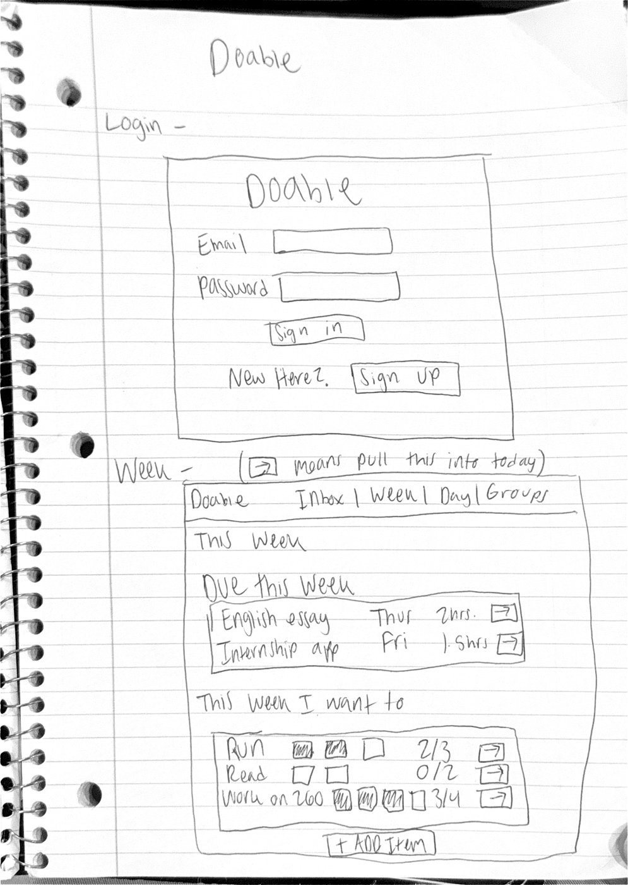
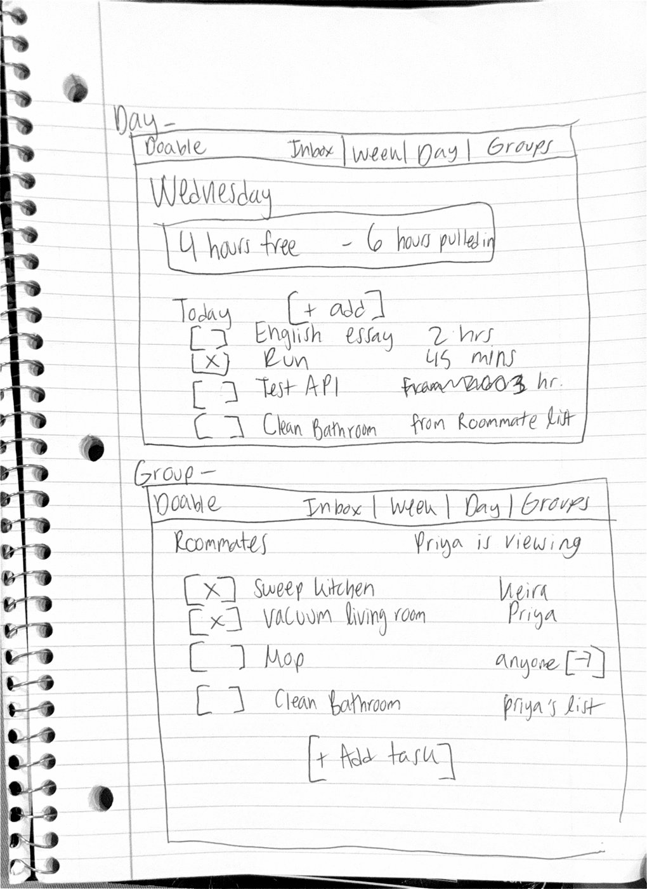
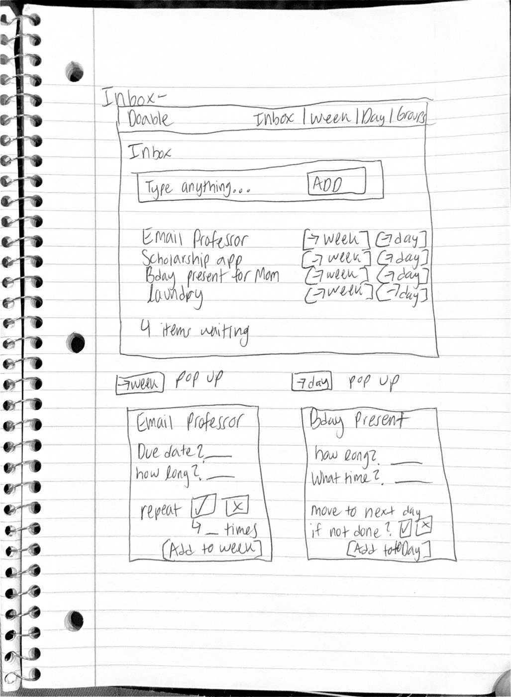

# Doable

[My Notes](notes.md)

A task planning app that turns everything you have going on into a realistic plan for your week and each day.

> [!NOTE]
> This is a template for your startup application. You must modify this `README.md` file for each phase of your development. You only need to fill in the section for each deliverable when that deliverable is submitted in Canvas. Without completing the section for a deliverable, the TA will not know what to look for when grading your submission. Feel free to add additional information to each deliverable description, but make sure you at least have the list of rubric items and a description of what you did for each item.

> [!NOTE]
> If you are not familiar with Markdown then you should review the [documentation](https://docs.github.com/en/get-started/writing-on-github/getting-started-with-writing-and-formatting-on-github/basic-writing-and-formatting-syntax) before continuing.

### Elevator pitch

Doable is a task planning app that takes everything you have going on and turns it into a realistic plan for your week and each day. Your week can have things you need to finish like an essay due Thursday and also things you want to do a certain number of times a week like running three days or reading twice. Each day you can choose what you want to pull from your week and focus on that day. This app can also look at your calendar so you know if what you picked will actually fit in your day, and shared lists let roommates or project groups work from the same list together. Doable helps you keep track of what you need to get done while also making time for the things you want to do more of.

### Design

Doable has five screens: login, inbox, week, day, and group. The sketches below put two screens on each page.

**Login and Week**

**Day and Group**

**Inbox**

### Key features

- **One place for everything**: add all of the tasks, assignments, errands, and goals you want to keep track of.
- **Two kinds of week items** — deadline tasks you complete once and weekly goals you want to complete a certain number of times.
- **Weekly goal progress** — see progress like 2 of 3 done throughout the week.
- **Build your own day** — choose what you want to pull from your week into today.
- **Know if it fits** — compare what you planned for the day with the free time you have on your Google Calendar.
- **Shared group lists** — roommates, classmates, or project groups can work from the same list.
- **Live updates** — changes to shared lists appear for everyone right away.

### Technologies

I am going to use the required technologies in the following ways.

- **HTML** - Provides the basic structure for the application with views for login, inbox, week, day, and group lists. Forms will be used for logging in and adding tasks, with navigation between the different parts of the app. Tasks and weekly goals will be organized into lists.
- **CSS** - Styles the application and makes it work well on both phones and computers. It will use a simple color scheme, good spacing, and clear organization so lists are easy to read. Animations can show when tasks are completed, weekly goal progress changes, or an item is moved from the week into today.
- **React** - Creates the interactive parts of the application using components for things like login, tasks, weekly goals, the week list, day list, and group lists. React will switch between the different views without reloading the page. It will also update the page immediately when users complete tasks, make progress on a weekly goal, or move something from their week into their day.
- **Service** - Provides backend endpoints for creating, editing, deleting, and completing tasks and weekly goals. It will also handle moving items from the week into the day, creating and joining groups, and accessing shared group lists. The service will support registering, logging in, and logging out users. It will also call the [Google Calendar API](https://developers.google.com/calendar/api/v3/reference/events/list) to get a user's calendar events so Doable can compare their available time with what they have planned for the day.
- **DB/Login** - MongoDB will store user accounts, tasks, weekly goals and their progress, shared group lists, and which users belong to each group. Users will need to be signed in to access their information and shared groups.
- **WebSocket** - Shared group lists will update in real time. When someone adds, edits, or completes a task, everyone currently looking at that group list will see the change without needing to refresh the page.

## 🚀 Specification Deliverable

> [!NOTE]
> Fill in this sections as the submission artifact for this deliverable. You can refer to this [example](https://github.com/webprogramming260/startup-example/blob/main/README.md) for inspiration.

For this deliverable I did the following. I checked the box `[x]` and added a description for things I completed.

- [x] I completed the prerequisites for this deliverable (Git commit requirement)- went through all of the pages on masteryls.
- [x] **Proper use of Markdown** - Used headings, bullet lists, bold text, links, and image references throughout this file.
- [x] **A concise and compelling elevator pitch** - Wrote a paragraph explaining how Doable turns everything you have going on into a realistic weekly and daily plan.
- [x] **Description of key features** - Listed seven features including the two kinds of week items, weekly goal progress, and shared group lists.
- [x] **Description of how you will use each technology** - Described HTML, CSS, React, Service, DB/Login, and WebSocket, including the Google Calendar API and how WebSocket keeps shared lists in sync.
- [x] **One or more rough sketches** - Added three images showing the login, week, day, group, and inbox screens.

## 🚀 AWS deliverable

For this deliverable I did the following. I checked the box `[x]` and added a description for things I completed.

- [x] **Rented EC2 server** - Rented an AWS EC2 instance to host my application in production.
- [x] **Leased domain name** - Leased `doablenow.click` through AWS Route 53 and pointed it at my EC2 instance.
- [x] **Server accessible** from my domain: from my domain: [https://doablenow.click](https://doablenow.click) - Confirmed the server responds and Simon is deployed and reachable at my domain.

## 🚀 HTML deliverable

For this deliverable I did the following. I checked the box `[x]` and added a description for things I completed.

- [x] I completed the prerequisites for this deliverable (Simon deployed, GitHub link, Git commits)
- [x] **HTML pages** - Created index (login), week, today, groups, and inbox pages, each representing a main component of the application.
- [x] **Proper HTML element usage** - Used header, nav, main, footer, and section semantically on every page instead of generic divs.
- [x] **Links** - Nav bar with links to all five pages appears on every page.
- [x] **Text** - Headings, descriptions, and labels throughout all pages.
- [x] **3rd party API placeholder** - Calendar table on today.html stands in for the Google Calendar API data.
- [x] **Images** - An image included on every page (login, week, today, groups, inbox).
- [x] **Login placeholder** - Login and create account forms on index.html, plus a placeholder showing the logged in username.
- [x] **DB data placeholder** - Tasks and weekly goals rendered on week.html/today.html, shared roommate list on groups.html.
- [x] **WebSocket placeholder** - Live Activity section on groups.html showing mocked real-time updates from other users.

## 🚀 CSS deliverable

For this deliverable I did the following. I checked the box `[x]` and added a description for things I completed.

- [x] I completed the prerequisites for this deliverable (Simon deployed, GitHub link, Git commits)
- [x] **Visually appealing colors and layout. No overflowing elements.** - Used a purple, coral, and mint color scheme with a dark navbar and footer on every page. Images use `img-fluid` and tables use `table-responsive` so nothing overflows
- [x] **Use of a CSS framework** - Used Bootstrap 5 (loaded from a CDN) for the navbar, grid, cards, list groups, buttons, forms, table, and alert.
- [x] **All visual elements styled using CSS** - Every page has the Bootstrap navbar and footer, with styled forms, lists, progress bars, the calendar table, and the live activity feed.
- [x] **Responsive to window resizing using flexbox and/or grid display** - Used the Bootstrap grid (`row` / `col-md-6`), `d-flex`, `flex-wrap`, and a flex column on `body` to keep the footer at the bottom. The navbar collapses into a hamburger menu on small screens.
- [x] **Use of a imported font** - Imported Poppins from Google Fonts and applied it to the whole site in `styles.css`.
- [x] **Use of different types of selectors including element, class, ID, and pseudo selectors** - Element (`body`, `h1, h2`), class (`.goal-progress`, `.activity-item`), ID (`#username-display`), and pseudo (`.card:hover`, `.list-group-item:hover`) selectors in `styles.css`.

## 🚀 React part 1: Routing deliverable

For this deliverable I did the following. I checked the box `[x]` and added a description for things I completed.

- [x] I completed the prerequisites for this deliverable (Simon deployed, GitHub link, Git commits)
- [x] **Bundled using Vite** - Installed vite as a dev dependency with dev, build, and preview scripts in package.json. Reorganized the pages into the Vite layout with a single index html and jsx at thr root. Replaced deployFiles.sh with deployReact.sh to run npm run build and copy the bundle to the server.
- [x] **Components** - Created five components in src/ with one folder for each page. I moved the <main> section from each old html into its compenent, editing the syntax to be in line with jsx. The shared nav and footer are in app.jsx and written once. app.css imports Bootstrap's css and js from the npm package in app.jsx.
- [x] **Router** - Added react router in app.jsx BrowserRouter wraps the app, the nav links are NavLinks and Routes maps the pages to their components. There is a NotFound component. Pages switch without a full reload.

## 🚀 React part 2: Reactivity deliverable

For this deliverable I did the following. I checked the box `[x]` and added a description for things I completed.

- [ ] I completed the prerequisites for this deliverable (Simon deployed, GitHub link, Git commits)
- [ ] **All functionality implemented or mocked out** - I did not complete this part of the deliverable.
- [ ] **Hooks** - I did not complete this part of the deliverable.

## 🚀 Service deliverable

For this deliverable I did the following. I checked the box `[x]` and added a description for things I completed.

- [ ] I completed the prerequisites for this deliverable (Simon deployed, GitHub link, Git commits)
- [ ] **Node.js/Express HTTP service** - I did not complete this part of the deliverable.
- [ ] **Static middleware for frontend** - I did not complete this part of the deliverable.
- [ ] **Calls to third party endpoints** - I did not complete this part of the deliverable.
- [ ] **Backend service endpoints** - I did not complete this part of the deliverable.
- [ ] **Frontend calls service endpoints** - I did not complete this part of the deliverable.
- [ ] **Supports registration, login, logout, and restricted endpoint** - I did not complete this part of the deliverable.
- [ ] **Uses BCrypt to hash passwords** - I did not complete this part of the deliverable.

## 🚀 DB deliverable

For this deliverable I did the following. I checked the box `[x]` and added a description for things I completed.

- [ ] I completed the prerequisites for this deliverable (Simon deployed, GitHub link, Git commits)
- [ ] **Stores data in MongoDB** - I did not complete this part of the deliverable.
- [ ] **Stores credentials in MongoDB** - I did not complete this part of the deliverable.

## 🚀 WebSocket deliverable

For this deliverable I did the following. I checked the box `[x]` and added a description for things I completed.

- [ ] I completed the prerequisites for this deliverable (Simon deployed, GitHub link, Git commits)
- [ ] **Backend listens for WebSocket connection** - I did not complete this part of the deliverable.
- [ ] **Frontend makes WebSocket connection** - I did not complete this part of the deliverable.
- [ ] **Data sent over WebSocket connection** - I did not complete this part of the deliverable.
- [ ] **WebSocket data displayed** - I did not complete this part of the deliverable.
- [ ] **Application is fully functional** - I did not complete this part of the deliverable.
